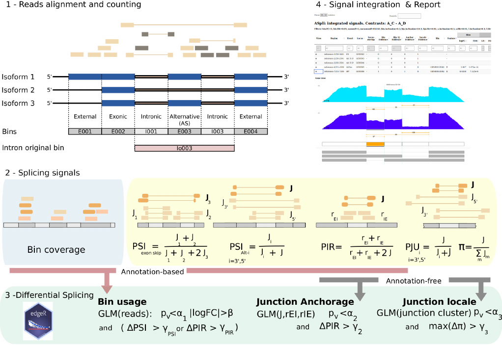
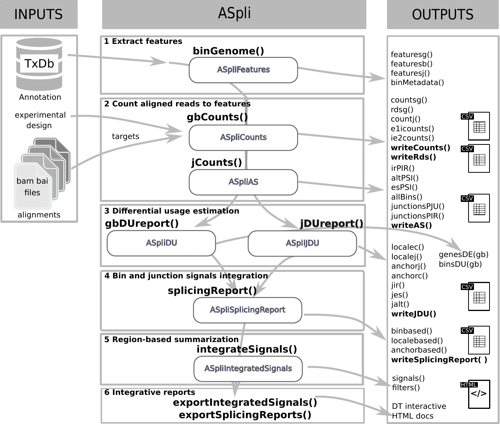
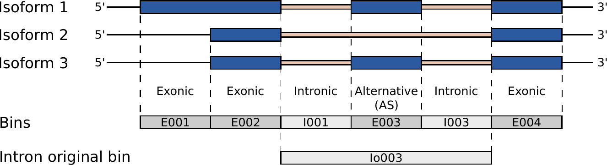
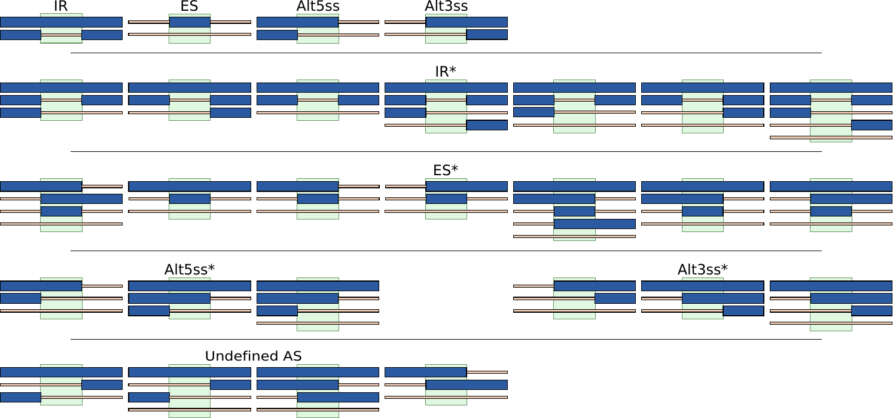
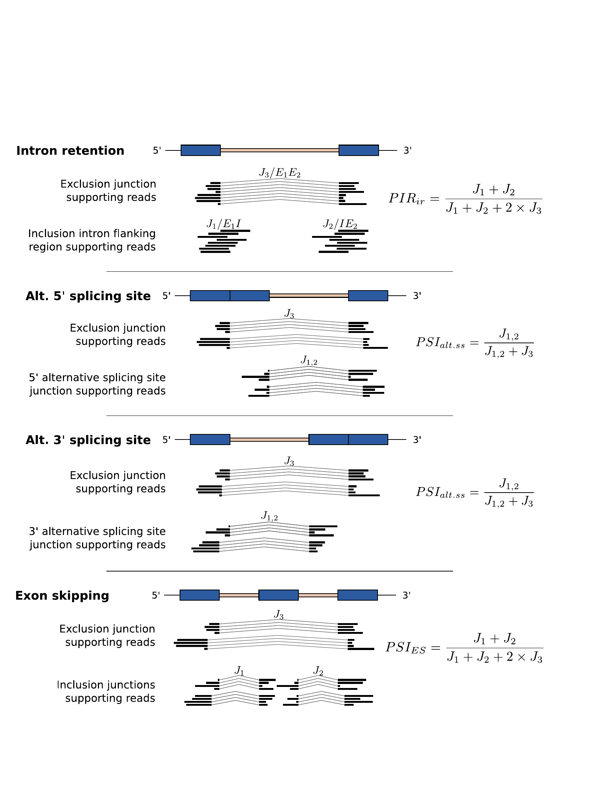
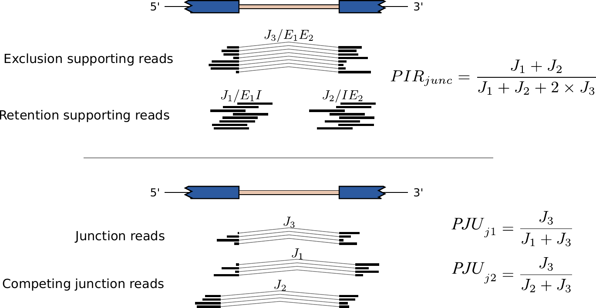
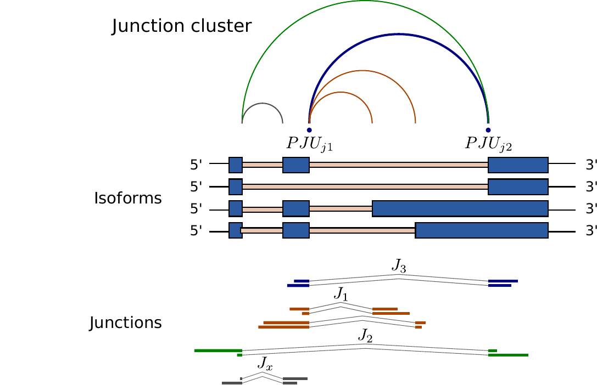
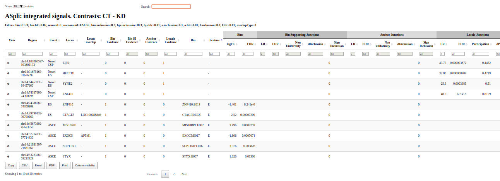
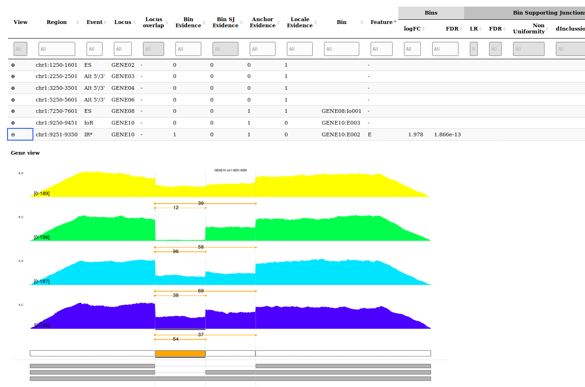

# Introduction

Alternative splicing (AS) is a common mechanism of post-transcriptional gene regulation in eukaryotic organisms that expands the functional and regulatory diversity of a single gene by generating multiple mRNA isoforms that encode structurally and functionally distinct proteins.

Genome-wide analysis of AS has been a very active field of research since the early days of NGS (Next generation sequencing) technologies. Since then, evergrowing data availability and the development of increasingly sophisticated analysis methods have uncovered the complexity of the general splicing repertoire.

In this vignette we describe how to use `ASpli`, an integrative and user-friendly R package that facilitates the analysis of changes in both annotated and novel AS events.

Differently form other approaches, ASpli was specifically designed to integrate several independent signals in order to deal with the complexity that might arise in splicing patterns. Taking into account genome annotation information, ASpli considers bin-based signals along with junction inclusion indexes in order to assess for statistically significant changes in read coverage. In addition, annotation-independent signals are estimated based on the complete set of experimentally detected splice junctions. ASpli makes use of a generalized linear model framework (as implemented in edgeR R-package [@Robinson2010]) to assess for the statistical analysis of specific contrasts of interest. In this way, ASpli can provide a comprehensive description of genome-wide splicing alterations even for complex experimental designs.

A typical ASpli workflow involves: parsing the genome annotation into subgenic features called bins, overlapping read alignments against them, perform junction counting, fulfill inference tasks of differential bin and junction usage and, finally, report integrated splicing signals. At every step ASpli generates self-contained outcomes that, if required, can be easily exported and integrated into other processing pipelines.

# Citation

*ASpli: Integrative analysis of splicing landscapes through RNA-seq assays*, Mancini E, Rabinovich A, Iserte J, Yanovsky M, Chernomoretz A, Bioinformatics, March 2021, \[[journal](https://doi.org/10.1093/bioinformatics/btab141),[preprint](https://tinyurl.com/mjvet53u)\]

# Quick start {#qstart}

Here is an example included in ASpli, for a pairwise comparison between 2 conditions (Control vs Treatment, 3 replicates each) using default parameters. For the sake of computational speed we will consider a custom gtf file (included in ASpli) containing info just for 10 artificial genes.
Extract features from genome, define *targets* data.frame with phenotype data, and *mBAMs* data.frame with phenotype data for merged BAMs:

```{r quickStart1, eval=TRUE, results="hide", message=FALSE}
library(ASpli)
library(GenomicFeatures)

# gtf preprocessing ----
gtfFileName <- aspliExampleGTF()
genomeTxDb  <- txdbmaker::makeTxDbFromGFF( gtfFileName )

# feature extraction ----
features    <- binGenome( genomeTxDb )

#bams and target file ----
BAMFiles <- aspliExampleBamList()
targets  <- data.frame(row.names = paste0('Sample',c(1:6)),
                       bam = BAMFiles[1:6],
                       f1  = c( 'control','control','control','treatment','treatment','treatment'),
                       stringsAsFactors = FALSE)
mBAMs <- data.frame( bam = sub("_[012]","",targets$bam[c(1,4)]),
                     condition = c("control","treatment"))

```

Read counting against annotated features:

```{r quickStart2, eval=TRUE, results="hide", message=FALSE}
gbcounts <- gbCounts(features=features, targets=targets,
                     minReadLength = 100, maxISize = 50000)
gbcounts
```

Junction-based *de-novo* counting and splicing signal estimation:

```{r quickStart2b, eval=TRUE, results="hide", message=FALSE}
asd <- jCounts(counts=gbcounts, features=features, minReadLength=100)
asd
```

Differential gene expression and bin usage signal estimation:

```{r quickStart3, eval=TRUE, results="hide", message=FALSE}
gb  <- gbDUreport(gbcounts, contrast = c(-1,1))
gb
```

Differential junction usage analysis:

```{r quickStart3b, eval=TRUE, results="hide", message=FALSE}
jdur <- jDUreport(asd, contrast=c(-1,1))
jdur
```

Bin and junction signal integration:

```{r quickStart4, eval=TRUE, results="hide", message=FALSE}
sr <- splicingReport(gb, jdur, counts=gbcounts)
```

Summary of integration of splicing signals along genomic-regions.

```{r quickStart4b, eval=TRUE, results="hide", message=FALSE}
is <- integrateSignals(sr,asd)
```

Export results:

```{r quickStart5, eval=TRUE, results="hide", message=FALSE}
exportIntegratedSignals(is,sr=sr,
                          output.dir = file.path( tempdir(), "aspliExample" ),
                          counts=gbcounts,features=features,asd=asd,
                          mergedBams = mBAMs)
```

# Getting started

## Installation

`ASpli` is available at the Bioconductor site and can be installed following these steps: `biocLite()`:

```{r installation, eval=FALSE}
if (!requireNamespace("BiocManager", quietly = TRUE))
    install.packages("BiocManager")

# The following line initializes usage of Bioc devel branch and should not be necessary after
# the next official release scheduled for October 2020
if(Sys.Date()<"2020-11-01") BiocManager::install(version='devel')
BiocManager::install("ASpli")
library(ASpli)
```

## Required input data

`ASpli` requires the following data in order to execute the analysis pipeline:

- `BAM` and `BAI` files for each analyzed sample.

- A genome annotation file in the TxDb format, as produced by the `GenomicFeatures` package. The `GenomicFeatures` package provides functions to create TxDb objects based on data downloaded from UCSC Genome Bioinformatics, BioMart or gff/gtf files. See "Creating New TxDb Objects or Packages" in the `GenomicFeatures` vignette for more details. In this example, a TxDb is built from a gtf file:

  ```{r makeTx, eval=FALSE}
  library(GenomicFeatures)
  TxDb <- txdbmaker::makeTxDbFromGFF(
    file="genes.gtf",
    format="gtf")
  ```

  The building of a `TxDb` object might be time consuming, depending on the size of your genome. If a `TxDb` has been already created, we strongly recommend saving it as a `sqlite` file and reloading it any time the analysis is run.

  ```{r saveTx, eval=FALSE}
   saveDb(TxDB,file="gene.sqlite")
  ```

  Please, `make sure all files use the same coordinate system`.

- IMPORTANT: In order to estimate uniform coverage statistics and to generate graphical reports through the `exportIntegratedSignals` function, replicate merged `BAM` files for each contrasted condition are needed. These merged BAMs can easily be computed from individual replicate BAM files using **samtools merge** utility (you can check http://www.htslib.org/doc/samtools-merge.html). Index for these merged BAM files should also be provided. They can be easily generated with **samtools index** utility (https://www.htslib.org/doc/samtools-index.html).

# ASpli overview

`ASpli` analyzes read coverage over *bins*, defined as maximal sub-genic features entirely included or entirely excluded from annotated mature tanscripts (see Figure [1](#fig:aspliWorkflow)). Read junctions are considered in order to provide supporting evidence of differential bin usage. Additionally, annotation-independent signals are estimated based on the complete set of experimentally detected splice junctions (see Figure [1](#fig:aspliWorkflow)).

We leverage on the statistical framework implemented in `edgeR` to asses for the statistical significance of different splicing signals in a consistent and unified way. As depicted in Figure [1](#fig:aspliWorkflow).3, statistically significant evidence is collected from: bin coverage differential signals, relative changes in junction’s flanking genomic regions (junction-anchorage signal), and junction usage variations displayed inside junction clusters (junction-locale signal).
Figure [1](#fig:aspliWorkflow).4 shows an example of the interactive html report generated as a final output.

<figure id="fig:aspliWorkflow">

<figcaption><strong>Figure 1.</strong> ASpli main features. Panel 1: binning of a three-isoform gene. Six bins (plus one intron-original bin) were defined. According to the local bin classification model two external, two intronic, one exonic and one alternative bin were recognized. Reads aligned to the genome are used to tally bin counts. In the figure, darker boxes represent non-annotated junctions and reads. Panel 2: Summary of splicing signals. Bin coverage is depicted in the blueish sub-panel. Junction-based signals are shown in the yellow sub-panel. The Percent-Spliced-In (PSI) statistics is used to quantify the inclusion evidence of exon-skipping and for the alternative use of 5’ or 3’ splicing sites. On the other hand, the Percent-of-Intron-Retention (PIR) is considered for IR events. It combines counts for the junction of interest and counts tallied over exon-intron boundaries (<span class="math inline"><em>r</em><sub><em>I</em><em>E</em></sub></span> and <span class="math inline"><em>r</em><sub><em>E</em><em>I</em></sub></span>). The Percent-Junction-Usage (PJU) statistics (rightmost junction-panel) quantifies the relative strength of a given junction with respect to locally <span><em>competing</em></span> ones for alternative 5’ or 3’ splicing sites. The participation coefficient <span class="math inline"><em>Π</em></span> serves to quantify the relative strength of a given junction <span class="math inline"><em>J</em></span> with respect to the set of junctions of the corresponding junction-cluster. For annotation-compliant events ASpli takes into account bin-coverage along with PSI<sub>exon skip</sub>, PSI<sub>Alt i</sub> or PIR signals depending on the event-class assigned to the analyzed bin. PIR and PJU<sub>i</sub> signals estimated for experimentally detected junctions are use to produce annotation-free statistics. Panel 3: Summary of differential splicing signals. ASpli applies a GLM approach on three different sets of reads and junctions to define complementary splicing cues: differential bin-coverage, junction anchorage and junction-locale signals. 4: Example of ASpli generated output. </figcaption>
</figure>

# Using `ASpli`

The workflow intended to be used with `ASpli` is divided in six main steps (Figure [2](#fig:ASpliStructure)).

1.  Extracting features from genome TxDb: ` binGenome() `

2.  Counting reads: ` gbCounts()`, ` jCounts()`

3.  Estimating differential signals:` gbDUreport()`, `jDUreport()`

4.  Generering reports: ` splicingReport() `, ` integrateSignals() `

5.  Exporting HTML reports: ` exportSplicingReport() `, ` exportIntegrateSignals() `

The main objects classes used to store data and perform operations are:

- `ASpliFeatures`: Contains genomic coordinates

- `ASpliCounts`: Contains number of reads overlapping each genomic feature

- `ASpliAS`: Contains counts of aligned junctions

- `ASpliDU`: Contains results of Differential expression and usage

- `ASpliJDU`: Contains results of Differential Junctions usage

- `ASpliSplicingReport`: Contains differential usage information using different evidences

- `ASpliIntegratedSignals`: Contains signals present in the region

At each step it is possible to access intermediate results. See Section [sec:outputs](#sec:outputs) for more details.

<figure id="fig:ASpliStructure">

<figcaption><strong>Figure 2.</strong> <code>ASpli</code> core Funcionalities </figcaption>
</figure>

## `binGenome`: Binning the genome  {#sectionBinG}

The `binGenome` method is a one-stop function to:

- split genes into subgenic features called bins

- extract junction, gene and bin coordinates

- infer bin splicing events from annotation

`binGenome`’s output is an object of class `ASpliFeatures`. Methods `featuresg`, `featuresb`, `featuresj` can be used to access genes, bins and junctions coordinates as `GRanges` (`GRanges` objects defined in the `GenomicRanges` package.)

```{r binGenome, eval=FALSE}
annFile       <- aspliExampleGTF()
aTxDb         <- makeTxDbFromGFF(annFile)
features      <- binGenome( aTxDb ) 
geneCoord     <- featuresg( features )
binCoord      <- featuresb( features )
junctionCoord <- featuresj( features )
```

In the case gene symbols were available, they could be appended as follow:

```{r binGenome2, eval=FALSE}
symbols       <- data.frame( row.names = genes( aTxDb ), 
                             symbol = paste( 'This is symbol of gene:',
                                             genes( aTxDb ) ) )
features      <- binGenome( aTxDb, geneSymbols = symbols ) 
```

### Bin definition {#sec:binDefinition}

Exon and intron coordinates are extracted from the annotation, but only those from multi-exonic genes are saved for further evaluation. When more than one isoform exists, some exons and introns will overlap. In the same spirit of [@pmid22722343], exons and introns are then subdivided into non-overlapping sub-genic features dubbed `bins`, defined by the boundaries of different exons across transcript variants. These so defined *bins* are maximal sub-genic features entirely included or entirely excluded from any mature transcript (see Fig [3](#fig:binDefinition)).

For an hypothetical gene named GeneAAA subgenic features are labelled as follow:

- **GeneAAA:E001**: defines first exonic bin

- **GeneAAA:I001**: defines first intronic bin

- **GeneAAA:Io001**: defines first `Intron original`

- **GeneAAA:J001**: defines first annotated junction of GeneAAA

- **chr.start.end**: defines an experimental junction

Bins and junctions are consecutively named from 5’ to 3’ of reference sequence, irrespective of their gene’s strand. This implies that lower numbers are always closer to the 5’ of forward strand. Alternative splicing bins are named as exons.
Exonic and intronic bins are further classified into *exclusively exonic bins*, *exclusively intronic bins*, or *alternative splicing bins* (AS) (See Figure [3](#fig:binDefinition)).

<figure id="fig:binDefinition">

<figcaption><strong>Figure 3.</strong> Schema of resulting bins from a gene with three hypothetical transcripts. Those bins that are exonic and intronic in different isoforms are named <em>AS bins</em>. </figcaption>
</figure>

Bins that overlap with the beginning or end of any transcript are labelled as **external**. Please note that an external bin of a transcript may overlap to a non external bin of another transcript, in these cases the bin is still labelled as **external**. In addition to these non overlapping bins, full introns are extracted from annotation and labelled as **Io** )

### Splicing event assignment {#sec:eventAssign}

Each AS bin is further classified considering a three-bin *local splicing model*. Splicing-event categories are assigned to a given bin based on the intronic/exonic character of the analyzed bin and its first neighbors (Figure [4](#fig:binAssignment)).

For genes presenting two isoforms, this model is able to unambiguously assign a well defined splicing event category to the analyzed bin: exon skipping (ES), intron retention (IR), alternative five prime splicing site (Alt5’SS), or alternative three prime splicing site (Alt3’SS) (see first row of Figure [4](#fig:binAssignment)).

<figure id="fig:binAssignment">

<figcaption><strong>Figure 4.</strong> Summary of assignment of splicing events to bins from minimum gene model. The bin being evaluated has a green background highlight. The blue boxes represents exons, while the little light orange boxes represent introns. Gene models shown are plus sense strand. </figcaption>
</figure>

When more than two isoforms are present, we still found it useful to use the three-bin local model to segment follow up analysis. For these cases (see rows 2-4 of Figure [4](#fig:binAssignment)) `ASpli` identify splicing events that involve: intronic subgenic regions surrounded by exons in at least one isoform (bin labelled as IR\*), exonic subgenic regions surrounded by two introns in at least one isoform (bin labelled as ES\*), exonic regions surrounded by intronic and exonic neighbor bins (bin labelled as Alt5’SS\* or Alt3’SS\*).

When it is not possible to get a clear splicing-type assignation (last row of Figure [4](#fig:binAssignment)), bins are labeled as *undefined AS* (UAS).

## Read counting {#sec:rcounts}

### Targets data.frame definition {#sec:targetsDef}

BAM file names and experimental factors should be provided as a dataframe that has as many rows as samples. The first column should be named *bam* and should contain the path to a BAM file. Next columns should be used to specify the different experimental factors for each sample.

For instance, for a two-factor design (e.g. *genotype* and *time*) the *targets* data.frame could have been defined like this:

```{r targetsDF2, eval=FALSE}
BAMFiles <- c("path_to_bams/CT_time1_rep1.BAM", "path_to_bams/CT_time1_rep2.BAM",
              "path_to_bams/CT_time2_rep1.BAM", "path_to_bams/CT_time2_rep2.BAM",
              "path_to_bams/TR_time1_rep1.BAM", "path_to_bams/TR_time1_rep2.BAM",
              "path_to_bams/TR_time2_rep1.BAM", "path_to_bams/TR_time2_rep2.BAM")
(targets <- data.frame( bam = BAMFiles,
                        genotype = c( 'CT', 'CT', 'CT',  'CT', 
                                      'TR', 'TR', 'TR', 'TR' ),
                        time     = c( 't1', 't1', 't2', 't2', 
                                      't1', 't1', 't2', 't2' ),
                         stringsAsFactors = FALSE ))
```

The *targets* dataframe contains experimental factor values for each sample. `ASpli` generates simple code-name for each experimental condition concatenating the corresponding factor levels. We recommend to check using the `getConditions()` function.

```{r targetsDF2b, eval=FALSE}
getConditions( targets )
```

**Important 1** The keyword *condition* is internally used by `ASpli` to store experimental condition code-names and SHOULD NOT be used as an experimental factor name in the definition of the *targets* data.frame.

**Important 2** Row-names can be defined for the *targets* data.frame to univoqually identify each sample through the analysis. However this is not mandatory. `ASpli` automatically use condition code-names to generate unique sample ids whenever default rownames (i.e. consecutive numbers) were detected in *targets* data.frame.

### `gbCounts`: Summarize read overlaps against all feature levels

The method `gbCounts()` counts the number of reads that overlaps each defined feature (i.e. genes, bins, junctions and intron/exon flanking regions). For genes and bins, read density values are also computed as the ratio between the number of reads and the length of a given feature.

By default (PE=TRUE) library is considered as paired-end and unstranded (strandMode=1).

```{r gbCounts, eval=FALSE}
gbcounts  <- gbCounts( features = features, 
                           targets = targets, 
                           minReadLength = 100, maxISize = 50000,
                           libType="SE", 
                           strandMode=0)
```

- `features`: An object of class `ASpliFeatures`. It is a list of GRanges at gene, bin and junction level

- `targets`: A dataframe containing sample, BAM and experimental factors as defined in Section [Targets data.frame definition](#sec:targetsDef).

- `minReadLength`: Reads shorter than *minReadLength* will not be considered to compute E1I and IE2 read coverage (see bellow).

- `maxISize`: Maximum intron expected size. Junctions longer than `maxISize` will be dicarded.

- `minAnchor`: Minimum percentage of *minReadLength* that should be aligned to an exon-intron boundary (see [Additional considerations](#sec:intronFlanking) ).

The result of `gbCounts()` method is an object of class `ASpliCounts`. Count and read density dataframes can be extracted using accesors methods. An extensive summary of the information stored in these tables is included in [sec:outputs](#sec:outputs).

Access data:

```{r gbCountAccessors, eval=FALSE}
GeneCounts <- countsg(counts)
GeneRd <- rdsg(counts)
BinCounts <- countsb(counts)
BinRd <- rdsb(counts)
JunctionCounts <- countsj(counts)
```

Export tables to text files:

```{r gbCountsWrite, eval=FALSE}
writeCounts(counts=counts, output.dir = "example")
writeRds(counts=counts, output.dir = "example")
```

#### Additional considerations {#sec:intronFlanking}

- At gene-level, for a given gene, the read count number is computed as the number of reads overlapping any exon included in the corresponding annotated gene model. If a single read overlaps more than one exon, it is counted only once. Note that **one read can overlap two different genes, in this case it is counted for both of them**.

- Every intron is considered as a potential retained intron. To analyze putative inton retention events, `ASpli` considers the corresponding upstream and downstream exons (E1 and E2, always in the forward sense). Then, following [@pmid25258385], new artificial ranges that overlap the two retention regions E1I (connecting exon E1 and intron I) and IE2 (connecting intron I and exon E2) are defined:

  - E1I: \[I$_{s}$- readLength (1 - minAnchor/100), I$_{s}$+ readLength (1 - minAnchor/100)\]

  - IE2: \[I$_{e}$- readLength (1 - minAnchor/100), I$_{e}$+ readLength (1 - minAnchor/100)\]

  where I$_{s}$ and I$_{e}$ are the intron start and end coordinates respectively. ` minAnchor ` is 10% of read length by default (parameter `minAnchor` )

  **Please check before start the read length of your sequenced library** Only those reads whith minimum overlap *minReadLength* with either $E1I$ or $IE2$ will be considered and counted.

  To access this data:

  ```{r gbCountAccessors2, eval=FALSE}
  e1iCounts <- countse1i(counts)
  ie2Counts <- countsie2(counts)
  ```

- Effective length: is the sum of the length of exonic bins and alternative bins (i.e. all bins except intronic bins).

- Junctions are extracted from BAM files. They are defined as those reads that aligned against disjoint region of the reference genome(N operator of CIGAR notation for aligned reads [@pmid19505943] ), and are essential for alternative splicing event quantification and discovery. Junction alignment confidence is extremely important and it should be controlled at the alignment step.

### `jCounts`: Summarize junctions inclussion indices PSI, PIR and PJU

PSI (percent of inclusion) and PIR (percent of intron retention) metrics (see bellow) are computed for each bin and experimental condition. The selection of which metric is used is based on the type of splicing event associated with each bin (see [Splicing event assignment](#sec:eventAssign)). In addition, annotation-free inclussion indices (PIR$_J$ and PJU, see bellow) are estimated using experimentally detected junctions.

```{r asd, eval=FALSE}
asd         <-  jCounts(counts = gbcounts, 
                     features = features, 
                     minReadLength = 100,
                     libType="SE", 
                     strandMode=0)
```

Novel arguments for this function call are:

- counts: An object of class `ASpliCounts`

- threshold: Minimum number of reads supporting junctions (Default=5)

Results: An object of class `ASpliAS`.. An extensive summary of the information stored in this object is included in [sec:outputs](#sec:outputs).

Accesors:

```{r asdAccesor, eval=FALSE}
irPIR  <- irPIR( asd )
altPSI <- altPSI( asd )
esPSI  <- esPSI( asd )
allBins      <- joint( asd )

junctionsPJU <- junctionsPIR( asd )
junctionsPIR <- junctionsPIR( asd )
```

Export tables to text files:

```{r asdAccesor2, eval=FALSE}
writeAS(as=asd, output.dir="example")
```

#### Junction supporting evidence of alternative bin usage {#sec:psir}

`ASpli` makes use of junction data as supporting evidence of alternative usage of bins. For a general differential splicing event affecting a given bin, it is always possible to define *exclusion* and *inclusion* junctions. The first class of junctions (noted as $J_3$) pass over the bin of interest, whereas the second ones (note as $J_1$ and/or $J_2$) quantify and support the inclusion of start and/or end bin boundaries in the mature transcript. Figure [5](#fig:pirEq) illustrates this point for the different types of splicing events that could affect a given bin. `ASpli` considers for this analysis junctions that are completely included within a unique gene and have more than a minimum number of reads supporting them (by default this number is five).

<figure id="fig:pirEq">

<figcaption><strong>Figure 5.</strong>PSI and PIR metrics estimation and their relationship with junctions</figcaption>
</figure>

PSI (percent spliced in) [@Schafer2015] and PIR (percent of intron retention) metrics are two well known statistics that can be used to quantify the relative weight of inclusion evidence for different kind of splicing events. For each bin, `ASpli` quantifies the inclusion strength in every experimental condition using the appropriate inclusion index (see Fig [5](#fig:pirEq)).

#### Annotation-free inclussion indices 

`ASpli` relies on the direct analysis of experimentally observed splicing junctions in order to study novel (i.e. non-annotated) splicing patterns.

For every experimental junction, `ASpli` characterizes local splicing patterns considering two hypothetical scenarios. For one hand, assuming that every detected junction might be associated to a possible intron that could be potentially retained, a $PIR_{junc}$ value is computed (upper panel of Figure [6](#fig:psir_junc)).
On the other hand, every junction also defines potential 5’ and 3’ splicing sites. It can be the case that one (in an alternative 5’ or 3’ scenario), or both ends (in case of exon skipping) were shared by other junctions. In this context, it is informative to characterize the relative abundance of the analyzed junction (dubbed $J_3$) with respect to the locally *competing* ones. `ASpli` estimates *percentage junction-usage* indices, $PJU_{J_1}$ and $PJU_{J_2}$, in order to evaluate and quantify this quantities (see bottom panel of figure [6](#fig:psir_junc)). In order to illustrate this point, we show in figure [7](#fig:jcluster) an hypothetical splicing scenario for a given junction of interest, $J_3$. It can be appreciated that $PJU_{J_1}$ quantifies the participation of this junction in the context of a splicing pattern involving the two orange competing junctions, whereas $PJU_{J_2}$ reports on the usage of $J_3$ in connection with the green competing junction.

<figure id="fig:psir_junc">

<figcaption><strong>Figure 6.</strong>PIR and PJU metrics for junctions</figcaption>
</figure>

<figure id="fig:jcluster">

<figcaption><strong>Figure 7.</strong>Percentage of junction usage.</figcaption>
</figure>

#### Additional considerations: {#additional-considerations}

- Only those junctions with a minimum number of counts (default=5) in **all** samples of at least 1 condition are used for PIR/PSI analysis.

- For each bin, a PIR or a PSI metric is calculated, depending on the splicing event category assigned to that bin (see section [Splicing event assignment](#sec:eventAssign)). If no splice event was assigned ( *this bin is not alternative*), an exon will be considered to be involved in a putative exon skiping splicing event, and an intron will be considered to be involved in a putative intron retention splicing event.

## Differential signals {#sec:difsignals}

`ASpli` leverages on the statistical framework developed by Smyth and collaborators, implemented in the edgeR R-package [@Robinson2010; @McCarthy2012], to assess for statistically significant changes in gene-expression, bin coverage and junction splicing signals. Under this approach, count data is modelled using a negative binomial model, and an empirical Bayes procedure is considered to moderate the degree of overdispersion across units.

In order to study splicing patterns, gene expression changes should be deconvolved from overall count data. On a very general setting, what we are looking for is to test whether a given unit of a certain group of elements displays differential changes respect to the collective or average behavior. `ASpli` uses this general idea to assess for statistically significant changes in splicing patterns probed with different genomic features:

- bin-coverage signal: `ASpli` assesses for differential usage of bins comparing bin’s log-fold-changes with the overall log-fold-change of the corresponding gene.

- junction anchorage signal: For every experimentally detected junction, `ASpli` analyzes differential intron retention changes by considering log-fold-changes of a given experimental junction relative to changes in coverage of left and right junction flanking regions.

- junction locale signal: In the same spirit than MAJIQ and LeafCutter, `ASpli` defines junction-clusters as sets of junctions that share at least one end with another junction of the same cluster (see Figure [7](#fig:jcluster)). In order to characterize changes for a given junction along experimental conditions, `ASpli` weighs log-fold-change of the junction of interest relative to the mean log-fold-change of junctions belonging to the same cluster.

`ASpli` makes use of the functionality implemented in the diffSpliceDGE function of the edgeR package to perform all of this comparisons within a unified statistical framework. Given a set of elements (i.e. bins or junctions) of a certain group (i.e. genes, anchorage group or junction-cluster), a negative binomial generalized log-linear model is fit at the element level, considering an offset term that accounts for library normalization and collective changes. Differential usage is assessed testing coefficients of the GLM. At the single element-level, the relative log-fold-change is reported along with the associated p-value and FDR adjusted q-values. In addition a group-level test is considered to check for differences in the usage of any element of the group between experimental conditions (see *diffSpliceDGE* documentation included in edgeR package for details [@Robinson2010]).

### `gbDUreport`: Bin-based coverage differential signals of AS {#sec:du}

To run this analysis:

```{r gbDUreport, eval=FALSE}
 gb <- gbDUreport( counts, 
             minGenReads = 10, 
             minBinReads = 5,
             minRds = 0.05, 
             contrast = NULL, 
             ignoreExternal = TRUE, 
             ignoreIo = TRUE, 
             ignoreI = FALSE,
             filterWithContrasted = TRUE,
             verbose = TRUE,
             formula = NULL,
             coef = NULL)
```

Summary of arguments:

- minGenReads (Default=10): Genes with at least an average of minGenReads reads for **any** condition are included into the differential expression test. Bins from genes with at least an average of minGenReads reads for **all** conditions are included into the differential bin usage test.

- minBinReads (Default=5): Bins with at least an average of minGenReads reads for any condition are included into the differential bin usage test.

- minRds (Default=0.05) = genes with at least an average of read density for any condition are included into the differential expression test. Bins belonging to genes with at least an average of minRds read density for **all** conditions are included into the differential bin usage test. Bins with at least an average of minRds read density for **any** condition are included into the differential bin usage test.

- ignoreExternal (Default = TRUE): Ignore firts or last transcript bins

- ignoreI(Default = FALSE) : Ignore intronic bins, test is performed only for exons.

- ignoreIo (Default = TRUE): Ignore original introns.

- contrast: Numeric vector of length equal to the number of experimental conditions (as defined by `targets`). The values of this vector are the coefficients of each condition (in the order given by given by `getConditions()`) to set up the contrast of interest. If contrast = NULL (and also formula=NULL ), a pairwise comparison between the second and the first conditions will be considered for calculations(i.e. contrast= c(-1,1,0,...0))

- filterWithContrasted: logical value. If TRUE (default) bins, genes and junctions will be filtered by read counts and read densities using data from the conditions that will be used in the sought comparison (i.e. those which coefficients in contrast argument are different from zero). If FALSE, all conditions will be considered at filtering time. *It is strongly recommended do not change this value*

- verbose: shows details of calculations (Default=TRUE)

- formula: A formula can be used to specify a specific term to be tested. If *coef* is specified, then that coefficient will be tested. If not, it defaults to the last term in the formula.

- coef: for formula only. The coefficient to be tested. If NULL the test defaults to the last term in the formula

The result of `gbDUreport()` method is an object of class `ASpliDU`. Gene expression and bin differential usage information can be extracted using accesors methods. An extensive summary of the information stored in this object is included in [sec:outputs](#sec:outputs).

Accesors:

```{r asdAccesor3, eval=FALSE}
geneX  <- genesDE( gb )
binDU  <- binsDU( gb )
```

Export tab delimited tables:

```{r gbCountsWrite2, eval=FALSE}
writeDU(gb, output.dir = "example")
```

#### Additional considerations {#additional-considerations-1}

- Bins and junctions from expressed genes are considered if they have enough supporting reads (Default=5) in at least one condition.

- *External bins* are excluded by default in the analysis. However, an *external* bin for one isoform can overlap to a *non external* bin from other isoform that can participate in alternative splicing regulation, `ASpli` allows to optionally include them.

- Io (*original intron*) bins, excluded by default.

  Note that the inclusion of those bins affects the estimation of corrected p-values (fdr). The information provided by Io bins are highly correlated with their sub bins and increase largely the number of events to be analyzed. The fdr correction become more strict and there is a violation on the fdr correction assupmtion that all individual tests are independent from each other. If an Io bin shows a significant change, there is a very high chance that at least one of their sub bins also shows a significant change.

### `jDUreport`: Junction-centered analysis of AS {#sec:jdureport}

Based on abundance information of experimentally detected junctions, `jDUreport` considers J$_1$, J$_2$ and J$_3$ junction sets, as defined in [6](#fig:psir_junc), to analyze annotation-free *junction-anchorage* and *junction-locale* alternative splicing signals (see [Differential signals](#sec:difsignals)). In addition, for every annotated bin, this functions tests junction supporting evidence of bin usage (see [5](#fig:pirEq)).

To run this analysis:

```{r jDUreport, eval=FALSE}
jdu <- jDUreport(asd, 
            minAvgCounts                       = 5, 
            contrast                           = NULL,
            filterWithContrasted               = TRUE,
            runUniformityTest                  = FALSE,
            mergedBAMs                         = NULL,
            maxPValForUniformityCheck          = 0.2,
            strongFilter                       = TRUE,
            maxConditionsForDispersionEstimate = 24,
            formula                            = NULL,
            coef                               = NULL,
            maxFDRForParticipation             = 0.05,
            useSubset                          = FALSE)
```

Summary of arguments:

- asd: An object of class `ASpliAS` with results of PSI and PIR using experimental junction

- minAvgCounts (Default=5): Minimum average counts for filtering.

- runUniformityTest (Defaults = FALSE): Run uniformity test on **Intron Retention** in order to detect non-uniform read coverage along the intron. This test compares the standard deviation of the inner intron region (11 bases from both ends) to the mean of both intron ends. Numbers closer to 0 mean more uniform coverage. This is an experimental feature, requires the existence of one merged BAM per experimental condition and takes some time to run.

- mergedBAMs: Should be specified if *runUniformityTest*=TRUE. It is a two column data.frame specifying the path to replicate-merged BAMs for each tested condition. Columns should be named: *bam* and *condition* respectively. *If no merged BAMs exist (for example, paired samples without replicates), use the same BAMs as targets.*

- maxPValForUniformityCheck: To speed up uniformity test only check junctions with pval \< maxPValForUniformityCheck (Default=0.2)

- strongFilter: If strongFilter is TRUE, then we discard junction clusters with at least one junction that doesn’t pass the filter.

- maxConditionsForDispersionEstimate: In order to reduce resource usage, estimate dispersion for statistics tests with a reduced number of conditions.

- maxFDRForParticipation: In order to calculate junctionPSI participation, only use significant junctions *(ie junctions with FDR \< maxFDRForParticipation).* (Default=0.05)

- useSubset: Experimental. *It is strongly recomended to leave the default, FALSE.*

Results are stored in an `ASpliJDU` object. Note that this analysis considers junctions that are completely included within a unique gene and have enough supporting reads (MinAvgCounts, Default = 5)

Accesors:

```{r jDUreportAccesors, eval=FALSE}
 localej( jdu )
 localec( jdu )
 
 anchorj( jdu )
 anchorc( jdu )
 
 jir( jdu )
 jes( jdu )
 jalt( jdu )
```

`localc` and `localj` together with `anchorc` and `anchorj` data.frames provide information regarding statistically significant changes observed in connection with junction usage inside *locale* and *anchorage*-junction clusters respectively. `jir`, `jes` and `jalt` accessors provide information regarding junction support of bin usage.

Export tab delimited table:

```{r jDUreportAccesorsX, eval=FALSE}
writeJDU(jdu,output.dir = "test")
```

#### Additional considerations {#additional-considerations-2}

As an option, `jDUreport` checks the non-uniformity level of the read coverage observed in intronic bins. We report the ratio between the standard deviation of the inner intronic bin region (11 bases from both ends) coverage to the mean of both bin’s external ends. Values closer to 0 mean that the coverage can be considered uniform and the event is probably an Intron Retention. In order to perform this calculation replicate merged BAMs for each condition are needed. The path to the bam files should be specify through the *mergeBams* argument (e.g. the *mBAMs* data.frame in the example of Section [Quick start](#qstart)). The calculation takes some time to run so it defaults to FALSE.

## Integrative reports {#sec:integration}

### `splicingReport`: bin and junction signals integration

This function combines differential splicing information from different sources. Bin and junction usage information is integrated in three steps. First, *bin* and annotated junction information (`jir`, `jes`, `jalt`) are consolidated. Then, bins that overlap with *locale*-J3 junctions (junctions that cover the entire locale region) are identified and the corresponding signals are combined. Finally, the same procedure is performed for bins and *anchorage*-J3 junctions.

To run this analysis

```{r splicingReport, eval=FALSE}
sr      <- splicingReport(gb, 
                          jdur, 
                          counts)
```

Results are stored in an `ASpliSplicingReport` object.

Accesors:

```{r splicingReportA, eval=FALSE}
 binbased( sr )
 localebased( sr )
 anchorbased( sr )
```

`binbased(sr)` data.frame combines information from bins and annotated junctions. For each case, either $\Delta PSI$ or $\Delta PIR$ statistics is reported based on the *bin* splicing type. `localebased(sr)` is a data.frame with information from bins and *locale* junctions. Statistics for each junction are located in columns prefixed with "junction" and statistics for the corresponding cluster are prefixed with the "cluster" keyword. Changes in *participation* coefficients are also reported. If *locale* clusters matched a *bin*, the coresponding bin statistics are also included. The data structure of `anchorbased(sr)` data.frame is similar to the *localebased(sd)* one. All data.frames also include junction count records for debugging purposes.

Export tab delimited table (see [exportSplicingReport: Export splicing reports in HTML pages.](#sec:reports) for interactive HTML reports):

```{r splicingReportA2, eval=FALSE}
writeSplicingReport( sr, output.dir = "test")
```

### `integrateSignals()`: Region specific summarization of differential usage signals.

This function integrates different usage signals reported in overlaping genomic regions:

- bin signal: a bin is called differentially-used by `ASpli` if it displays statistically significant coverage changes (fdr $< 0.05$, by default) and, additionally, one of the two supplementary conditions hold: either the bin fold-change level is greater than a given threshold (3 fold changes, by default) or changes in inclusion levels of bin-supporting junctions ($\Delta PIR$ or $\Delta PSI$ according to the bin class) surpass a predefined threshold ($0.2$ by default).

- *anchorage* signal: statistically significant changes are found at the cluster level (cluster.fdr $<0.05$ by default) for the considered $\{J_1,J_2,J_3\}$ junction set (see upper panel of Fig [6](#fig:psir_junc)) and, at the same time, $|\Delta PIR_{J_3}|$ is larger than a given threshold (0.3 by default).

- *locale* signal: statistically significant changes are found at the cluster level (cluster.fdr $<0.01$ by default) for the analysed junction cluster $\{J_1,...,J_S,...,J_n\}$ (see [7](#fig:jcluster)) and, at the same time, there is at least one junction $J_S$ within the cluster presenting statistically significant changes at the single unit level (junction.fdr $<0.05$, by default) with $|\Delta Participation_{J_S}|$ larger than a given threshold (0.3 by default). In the case that statistically significative changes were detected at the unit-level for more than one junction of a given cluster, the one displaying the largest participation change was considered and reported as the cluster’s representative junction.

```{r integrateSignals, eval=FALSE}
is    <- integrateSignals(sr, asd,
                 bin.FC = 3, bin.fdr = 0.05, bin.inclussion = 0.2,
                 nonunif = 1, usenonunif = FALSE, 
                 bjs.inclussion = 10, bjs.fdr = 0.01, 
                 a.inclussion   = 0.3, a.fdr = 0.01, 
                 l.inclussion   = 0.3, l.fdr = 0.01,
                 otherSources = NULL, overlapType = "any")
```

Arguments:

- sr: An object of class ASpliSplicingReport

- asd: An object of class ASpliDU

- bin.FC: fold change threshold for bin signals. By default only bin signals with bin.fc \> log2(3) are retained.

- bin.fdr: Maximum FDR for bin signals.

- bin.inclussion: Minimum level of change for junction support inclussion signals (either $\Delta$PIR or $\Delta$PSI) associated to bins who already passed bin.FC and bin.fdr filters.

- nonunif: Maximum value of non-uniforimty for intronic bins (nonunif \<\< 1 means homogeneous coverage)

- usenonunif: Whether to use non uniformity as filter.

- bjs.inclussion: Minimum level of change for junction support inclussion signals (either $\Delta$PIR or $\Delta$PSI).

- bjs.fdr: Maximum FDR for annotated junctions.

- a.inclussion: Minimum level of inclussion change for *anchorage* junctions.

- a.fdr: Maximum FDR for *anchorage* junctions.

- l.inclussion: Minimum level of *participation* change for *locale* junctions..

- l.fdr: Maximum FDR for *locale* junctions.

- otherSources: If user wants to compare `ASpli` results with results from other methods, *otherSources* must be a GenomicRange object with all the regions found with the other methods. It will be integrated with a new column next to signals information.

- overlapType: Matching criterium for region overlaps. Defaults to "any" and can be any of the following: "any", "start", "end", "within", "equal".

Results are stored in an `ASpliIntegratedSignals` object.

Accesors:

```{r integrateSignalsA, eval=FALSE}
 signals( is )
 filters( is )
```

`filters(is)` stores the parameter values used to filter the different usage signals to be integrated (e.g. minimum fold-changes, statistical thresholds, minimal inclussion values, etc).

`signals(is)` contains region-based information of splicing signals. Table [1](#tab:iiss) shows the first 5 columns of this data.frame. Columns b, bjs, ja and jl stand for bin, bin-junction-support, junction-anchorage and junction-locale signals. Non-zero entries indicate the presence of the corresponding signal for the considered genomic range. An asterisk indicates overlap but not an exact match between the genomic ranges where the examined signals were observed.

::: {#tab:iiss}
                region  b   bjs   ja   jl   ....
  -------------------- --- ----- ---- ---- ------
      Chr1:45560-45645  1    1    0    0   
    Chr1:387673-388267  1    1    1    1    ...
    Chr1:406793-406902  1    1    0    \*  

  : **Table 1.** First five columns of *signals(is)* data.frame
:::

In this example a bin-signal (*b*) was found in region *Chr1:406793-406902*. A matching bin-junction supporting signal was also reported (*bjs*), so both discoveries were merged. Finally, a significant *locale* cluster overlapped the region, but genomic ranges did not match, so an \* was used for that signal.

#### Event assignement

We adopted the following heuristics to classify the region-centered integrated splicing signals. Eventhough we found this classification scheme usefull in most situations, it is strongly advised to use it as a preliminary categorization of events. Further examination is advised in order to disentangle complex splicing patterns.

1.  For each region with *bin-coverage* signal, we try to find a matching region in *binbased(sr)* table. If a match is found, we assign that event to the corresponding bin-event class and report the corresponding statistical information. Otherwise, the signal is marked as **\***.

2.  For each region with *bin-junction support* (bjs) signal, we try to find a matching J3-junction in *binbased(sr)* table. If a match is found, junction statistics are retrieved. Otherwise, the signal is marked as **\*** in the *bjs* column.

3.  For each region with *anchorage-signal*, we try to find a matching J3-junction in *anchorbased(sr)* table. If a match is found, junction statistics are retrieved. Otherwise, we try to find a matching J3-junction of a *Io bin* in the *binbased(sr)* table. If a match is found, the event is marked as **IoR**. Otherwise, we try to find a *bin-signal* matching region. In case no match is reported at this instance the event is marked as *Novel Alternative Splicing Pattern* **NASP**. If a match is reported but the bin is marked as **\***, then the event is marked as *Complex Splicing Pattern* **CSP**. Finally, if no J3-junction in *anchorbased(sr)* table is found, the signal is marked as **\***.

4.  For each region with *locale signal*, we look for a matching cluster in *localebased(sr)* table. If any, we retrieve the statistical information from that cluster. Otherwise we try to find a cluster with a matching J3 junction. If no match is found, then the *locale* signal columns is marked with an **\***. In order to categorize the event we adopte the following heuristic:

    1.  If all junctions share the same end or start coordinates, we check if all bins in between are of the same type (i.e. exons or introns). If this is the case, then this is an **Alt 5’/3’** event. Otherwise, the event is marked as **CSP**.

    2.  If the cluster is composed of three junctions and not all junctions share the same end or start, we check it there is a cluster with a matching J3-junction. If this is the case, the event is labelled as an **ES** event. Otherwise, it is marked as a **CSP** event. If some of the junctions in the cluster were novel, then the event is classified as a novel one: **NASP**.

    3.  For each of the other unclassified events, we check whether they involve *exonic* features. If this were the case, we mark them as *alternative splicing affecting a consensus exon* **ASCE** events. On the other hand, for *intronic* features, if some signals were marked as **\*** we clasify the event as **CSP**. Othewise, the event is marked as an **IR**.

<figure id="fig:integrateSignals">

<figcaption><strong>Figure 8.</strong> Heuristics used to categorized splicing events </figcaption>
</figure>

### `exportSplicingReport`: Export splicing reports in HTML pages. {#sec:reports}

This function makes use of the `DT` R-package [@DTpackage], a wrapper of the JavaScript library ’DataTables’ to export *splicing report* results into interactive HTML pages.

```{r exportSplicingReports, eval=FALSE}
exportSplicingReports( sr, 
                       output.dir="sr",
                       openInBrowser = FALSE, 
                       maxBinFDR = 0.2, 
                       maxJunctionFDR = 0.2 )
```

Arguments:

- sr: An object of class ASpliSplicingReport

- output.dir: HTML reports output directory

- openInBrowser: (Default = FALSE) If TRUE, results are automatically displayed just after exporting.

- maxBinFDR (Default = 0.2) Export info for bins with FDR \< maxBinFDR

- maxJunctionFDR (Default = 0.2): Export info for junctions with FDR \< maxJunctionFDR

The result is an HTML page, where you can easily browse the tables stored in an *ASpliSplicingReport object.*

### `exportIntegratedSignals()`: Export integrated signals into HTML pages. {#sec:reports2}

This function makes use of the `DT` R-package [@DTpackage], a wrapper of the JavaScript library ’DataTables’, to export region-based integrated signal results into interactive HTML pages.

```{r exportIntegratedSignals, eval=FALSE}
exportIntegratedSignals( is, output.dir="is", 
                         sr, counts, features, asd,
                         mergedBams, 
                         jCompletelyIncluded = FALSE, zoomRegion = 1.5, 
                         useLog = FALSE, tcex = 1, ntop = NULL, openInBrowser = F, 
                         makeGraphs = T, bforce=FALSE
                        )
```

Arguments:

- is: An object of class ASpliIntegratedSignals

- sr: An object of class ASpliSplicingReport

- counts: An object of class ASpliCount

- features: An object of class ASpliFeatures

- asd: An object of class ASpliAS

- output.dir: HTML reports output directory

- `mergedBams`: Dataframe with two columns, bams and conditions. Bams are paths to merged bam files for each condition. These will be used to produce coverage plots if *mageGraph*=TRUE.

- `jCompletelyIncluded`: If TRUE only plot junctions completely included inside the plot region. Otherwise plot any overlapping junctions, not necessarily contained in the region of interest

- `useLog`: Plot counts log

- `tcex`: Text size

- `ntop`: Only show n top signals

- `openInBrowser`: Open reports in browser when done

- `makeGraphs`: Generate graphs in reports

- `bforce`: Force plot generation even if plot already exists on disk

The result is an HTML page, where you can easily browse the tables stored in an *ASpliIntegratedSignals object.*

<figure id="fig:integratedSignals">

<figcaption><strong>Figure 9.</strong>Example of integrate signal DataTable report</figcaption>
</figure>

# Case studies

`ASpli` provides a small synthetic data set to test the whole pipeline. It consists of

- a **GTF** file for a a genome with ten genes with multiple isoforms with the corresponding annotation.

- a set of twelve **BAM** files from an experiment with a two$\times$two factorial design

- four merged **BAM** files (merged replicates, one per condition)

## 2x2 experimental design

The two factors in this example are called **f1** and **f2**.**f1** can have value **A** or **B** and **f2** can have value **C** or **D**, defining four conditions: **A.C**, **A.D**, **B.C** and **B.D**. Table [2](#tab:Ex01) summarizes the experimental design.

::: {#tab:Ex01}
  sample   f1   f2   replicate   condition
  -------- ---- ---- ----------- -----------
  1        A    C    0           A.C
  2        A    C    1           A.C
  3        A    C    2           A.C
  4        A    D    0           A.D
  5        A    D    1           A.D
  6        A    D    2           A.D
  7        B    C    0           B.C
  8        B    C    1           B.C
  9        B    C    2           B.C
  10       B    D    0           B.D
  11       B    D    1           B.D
  12       B    D    2           B.D

  : **Table 2.** Experimental design of the example data set
:::

The firts step of the workflow is to load the small *gtf*, build the TxDb object and extract their features. In this case `gtfFileName` contains the full path to the example gtf file in your system.

```{r Ex02.a, eval=FALSE}
#library( ASpli )
library( GenomicFeatures )
gtfFileName <- aspliExampleGTF()
genomeTxDb <- makeTxDbFromGFF( gtfFileName )
features <- binGenome( genomeTxDb )
```

Then you should define your *targets* table. `aspliExampleBAMList()` provides the full path to the BAMs files.

```{r Ex02.e, eval=FALSE}
BAMFiles <- aspliExampleBamList()

targets <- data.frame( 
  row.names = paste0('Sample',c(1:12)),
  bam = BAMFiles,
  f1 = c( 'A','A','A','A','A','A',
          'B','B','B','B','B','B'),
  f2 = c( 'C','C','C','D','D','D',
          'C','C','C','D','D','D'),
  stringsAsFactors = FALSE)
```

Experimental conditions are inferred from the experimental factors in the *target* dataframe:

```{r Ex02.g, eval=FALSE}
getConditions(targets)
```

We define a dataframe with path information for merged bams:

```{r Ex02.f, eval=FALSE}
mBAMs <- data.frame(bam      = sub("_[02]","",targets$bam[c(1,4,7,10)]),
                    condition= c("A_C","A_D","B_C","B_D"))
```

Next step is to overlap reads and features:

```{r Ex02.i, eval=FALSE}
gbcounts  <- gbCounts( features = features, 
                           targets = targets, 
                           minReadLength = 100, maxISize = 50000,
                           libType="SE", 
                           strandMode=0)
```

And also quantify junctions:

```{r Ex02.j, eval=FALSE}
asd<- jCounts(counts = gbcounts, 
                     features = features, 
                     minReadLength = 100,
                     libType="SE", 
                     strandMode=0,
                      threshold     = 5,
                      minAnchor     = 10)
```

At this point we can start asking different questions regarding differential gene expression and splicing patterns. `ASpli` allows to do this by defining *contrasts* or by using the *formula* approach. This feature allows the user to choose the framework that better (i.e. more easily) serve to test the sought effect.

### The contrast approach {#sec:contrast}

Table [3](#tab:Contrasts01) shows different contrasts that can be used to test different hypothesis:

::: {#tab:Contrasts01}
  Test                                                                          contrast
  ----------------------------------------------------------------------------- ----------------
  AS between **f2** C and D conditions, for **f1**=A samples                    c(-1, 1, 0, 0)
  AS between **f2** C and D conditions, for **f1**=B samples                    c( 0, 0,-1, 1)
  Interaction effect (i.e. differences between the above-mentioned contrasts)   c( 1,-1,-1, 1)

  : **Table 3.** Test and contrasts.
:::

To continue our mini-tutorial we will focus on the last contrast of Table [3](#tab:Contrasts01). We will test whether the differential patterns observed between D and C levels of **f2** are different for A and B **f1** levels. The interaction contrast corresponds to: $$\begin{equation}
I = ( B.D - B.C ) - ( A.D - A.C )
\end{equation}$$

As Table [3](#tab:Contrasts01) shows, taking in consideration the order given by `getConditions` function, the coefficients of the terms in this expression can be represented as the *contrast* vector $[ 1,-1,-1, 1]$.

We estimate gene differential expression and annotation-based differential splicing patterns for the contrast of interest as follow:

```{r Ex02.k, eval=FALSE}
gb      <- gbDUreport(gbcounts,contrast = c( 1, -1, -1, 1 ) )

```

`genesDE()` and `binsDU()` accesors report the statistical significance results. We can see that in this example no evidence of a statistically significant interaction term was found at gene expression level. However, 9 out of 14 bins displayed statistically significant interaction effect (fdr \< 0.01)

```{r Ex02.k2, eval=FALSE}
genesDE(gb)[1:5,]
binsDU(gb)[1:5,]
```

The analysis of annotation-free junction-based AS events can be done with [^1]:

```{r Ex02.l, eval=FALSE}
jdur    <- jDUreport(asd, contrast =  c( 1, -1, -1, 1 ))
```

Results for junction-based events matching bin ranges can be accessed through `jir(jdur)`, `jes(jdur)` and `jalt(jdur)` accesors (see [jDUreport: Junction-centered analysis of AS](#sec:jdureport)).

Here we show the output corresponding to results of the *locale*-junction cluster analysis. Information regarding *locale* cluster-level tests can be retrieved using:

```{r Ex02.kk, eval=FALSE}
localec(jdur)[1:5,]
```

Rownames correspond to cluster-ids. Rows are ordered by FDR values. The *participation* and *dParticipation* values reported for each cluster correspond to the values obtained for the cluster’s junction presenting the largest and most significant participation change. Note that NA’s are reported for cluster-7 as no statistically significant changes were found for any junction of that cluster.

*localej(jdur)* shows locale-information for each analyzed junction, reporting results of statistical tests at junction level in the first 8 columns:

```{r Ex02.kkk, eval=FALSE}
localej(jdur)[1:5,1:8]
```

We integrate all our data:

```{r Ex02.m, eval=FALSE}
sr      <- splicingReport(gb, jdur, counts = gbcounts)
is      <- integrateSignals(sr,asd)
```

And finally we export integrate signals into an interactive HTML page

```{r Ex03, eval=FALSE}
exportIntegratedSignals( is, output.dir="aspliExample", 
                         sr, gbcounts, features, asd, mBAMs)

```

### The formula approach {#sec:formula}

In `ASpli` it is also possible to use *formulas* to test different hypothesis. In our example we will consider the following formula to model our data:

```{r Ex04, eval=FALSE}
 form <- formula(~f1+f2+f1:f2)
```

This formula corresponds to the following model matrix:

```{r Ex05, eval=FALSE}
 model.matrix(form,targets)
```

Table [4](#tab:Formulas01) summarizes three statistical comparisons that could be easily implemented considering the second, third and fourth coefficient of the model:

::: {#tab:Formulas01}
          Test              contrast      coefficient
  --------------------- ---------------- -------------
         B.C-A.C         c(-1, 0, 1, 0)        2
         A.D-A.C         c(-1, 1, 0, 0)        3
   (B.D-B.C)-(A.D-A.C)   c( 1,-1,-1, 1)        4

  : **Table 4.** Experimental design of the example data set.
:::

In this way, to test for an interaction effect with the *formula* framework, we should run:

```{r Ex02.k3, eval=FALSE}
gb      <- gbDUreport(counts, formula = form , coef = 4)
jdur    <- jDUreport(asd, formula = form, coef = 4 ,
                     runUniformityTest = TRUE,
                     mergedBams = mBAMs)
```

## Paired experimental design

The *formula* approach becomes extremely useful, for instance, to handle paired designs. We will consider a subset of the originally included samples to simulate a paired experiment (see Table [5](#tab:ExPaired)). In this case **f1** could denote experimental units and **f2** levels, treatment-control conditions.

::: {#tab:ExPaired}
  sample   f1   f2   replicate   condition
  -------- ---- ---- ----------- -----------
  1        A    C    0           A.C
  4        A    D    0           A.D
  7        B    C    0           B.C
  10       B    D    0           B.D

  : **Table 5.** Experimental design for a minimalistic paired design
:::

```{r Ex02.kp, eval=FALSE}
targetPaired <- targets[c(1,4,7,10),]

gbcounts  <- gbCounts( features = features, 
                           targets = targets, 
                           minReadLength = 100, maxISize = 50000,
                           libType="SE", 
                           strandMode=0)
asd    <- jCounts(counts = gbcounts, 
                     features = features, 
                     minReadLength = 100,
                     libType="SE", 
                     strandMode=0)
form   <- formula(~f1+f2)
gb     <- gbDUreport(gbcounts, formula = form)
#jdur   <- jDUreport(asd    , formula = form)
#sr <- splicingReport(gb, jdur, counts = counts)
#is <- integrateSignals(sr,asd,bjs.fdr = 0.1, bjs.inclussion = 0.1, l.inclussion=0.001,l.fdr = 1)
# exportSplicingReports(sr,output.dir="paired")
#exportIntegratedSignals(is,output.dir="paired",sr,counts,features,asd,mBAMs,tcex=2)
```

Note: for a large number of experimental units you might disable the graph generation option `makeGraphs=FALSE` in `exportIntegratedSignals` function call.

# Migrating from ASpli v1 {#sec:migration}

Scripts written for `ASpli` 1.x use functions that were removed from the
package (`loadBAM`, `readCounts`, `AsDiscover`, `DUreport`,
`DUreportBinSplice`, `junctionDUreport`, `mergeBinDUAS`, `filterDU` and
`plotGenomicRegions`). The following table shows which function replaces each
of them; a more detailed description is available in `?"ASpli-defunct"`.

| Removed function | Replacement |
|:-----------------|:------------|
| `loadBAM`, `readCounts` | `gbCounts()` |
| `AsDiscover` | `jCounts()` |
| `DUreport`, `DUreportBinSplice` | `gbDUreport()` (`DUreport.norm()` and `DUreport.offset()` are still available) |
| `junctionDUreport` | `jDUreport()` |
| `mergeBinDUAS`, `filterDU` | `splicingReport()`, `integrateSignals()` and `filterSignals()` |
| `plotGenomicRegions` | `exportSplicingReports()` and `exportIntegratedSignals()` |

A typical v1 script looked like this:

```{r v1workflow, eval=FALSE}
features <- binGenome( genomeTxDb )
bams     <- loadBAM( targets )
counts   <- readCounts( features, bams, targets, cores = 1,
                        readLength = 100, maxISize = 50000 )
du       <- DUreport.norm( counts, targets, contrast = c(-1, 1) )
as       <- AsDiscover( counts, targets, features, bams,
                        readLength = 100, threshold = 5, cores = 1 )
merged   <- mergeBinDUAS( du, as, targets, contrast = c(-1, 1) )
plotGenomicRegions( merged, genomeTxDb, features, targets )
```

and the equivalent code for the current workflow (see the
[Quick start](#qstart)) is:

```{r v2workflow, eval=FALSE}
features <- binGenome( genomeTxDb )
gbcounts <- gbCounts( features = features, targets = targets,
                      minReadLength = 100, maxISize = 50000 )
asd      <- jCounts( counts = gbcounts, features = features,
                     minReadLength = 100 )
gb       <- gbDUreport( gbcounts, contrast = c(-1, 1) )
jdur     <- jDUreport( asd, contrast = c(-1, 1) )
sr       <- splicingReport( gb, jdur, counts = gbcounts )
is       <- integrateSignals( sr, asd )
exportIntegratedSignals( is, sr = sr, output.dir = "aspliExample",
                         counts = gbcounts, features = features,
                         asd = asd, mergedBams = mBAMs )
```

The main differences are: BAM files are read one by one by `gbCounts()` (there
is no `bams` object anymore), `readLength` was renamed `minReadLength`,
`libType` and `strandMode` describe the library, `jCounts()` only needs the
output of `gbCounts()`, and the plots of genomic regions are produced by the
`export*` functions as interactive HTML reports.

# Appendix: Ouputs Details

Here is a brief explanation of the info present in `ASpli` objects. Some columns are common in several tables. 

## ASpliCounts {#asplicounts .unnumbered}

### Gene counts (`countsg`) and gene read densities (`rdsg`)  {#gene-counts-countsg-and-gene-read-densities-rdsg .unnumbered}

(see table [6](#tab:counts.gene) for an example)

- **row.names**:: Gene name as reported in annotation data.

- **symbol**:: An optional name for the gene, that must be provided at the moment of feature extraction (see section [Bin definition](#sec:binDefinition)).

- **locus_overlap**:: overlapping *loci*.

- **gene_coordinates**:: format `chromosome:start-end`.

- **start, end,length**::

- **effective_length**:: gene length using only annotated exons.

- **sample data**:: gene read counts/densities (one column per sample).

###  Bin counts (`countsb`) and bin read densities (`rdsb`)  {#bin-counts-countsb-and-bin-read-densities-rdsb .unnumbered}

- **row.names**:: see [binGenome: Binning the genome ](#sectionBinG).

- **feature**:: **E** for exonic bins, **I** for intronic bins and **Io** for introns before splitting. See [binGenome: Binning the genome ](#sectionBinG)

- **event**:: Alternative splicing event asigned (see section [Bin definition](#sec:binDefinition):[Splicing event assignment](#sec:eventAssign))

- **sample data**:: bin read counts/densities (one column per sample)

### Junction counts (`countsj`) {#junction-counts-countsj .unnumbered}

- **row.names**:: Junction’s name in format `chromosome.start.end` (see [binGenome: Binning the genome ](#sectionBinG)).

- **junction**:: If junction coincides with a junction inferred from the annotation, the name is shown as is given in section [binGenome: Binning the genome ](#sectionBinG), otherwise it is `noHit`.

- **gene**:: Locus that contains the junction.

- **strand**:: gene’s strand

- **multipleHit**:: `yes` if junction spans multiple genes.

- **bin_spanned**:: Bin’s names spanned by the junction.

- **j_within_bin**:: If junction falls within a single bin, the name of that bin is shown.

- **sample data**:: Junction counts (one column per sample).

### E1I (`countse1i`) and IE2 (`countsie2`)  {#e1i-countse1i-and-ie2-countsie2 .unnumbered}

- **row.names**:: Junction name in format `chromosome.start.end` (see [binGenome: Binning the genome ](#sectionBinG)).

- **junction**:: If junction coincides with a junction inferred from the annotation, the name is shown as is given in section [Bin definition](#sec:binDefinition), otherwise contains `noHit`.

- **gene**:: Name of the locus that contains the junction.

- **strand**:: Strand sense of the gene.

- **multipleHit**:: `yes` if junction spans multiple genes.

- **sample data**:: Junction counts (one column per sample).

::: {#tab:counts.gene}
  Row names   symbol   locus_overlap   gene_coordinates   start   end    length   effective_length   Sample 1   Sample 2   ...
  ----------- -------- --------------- ------------------ ------- ------ -------- ------------------ ---------- ---------- -----
  GENE01      GENE01   \-              chr1:1-700         1       700    700      700                324        314        n
  GENE02      GENE02   \-              chr1:1001-1800     1001    1800   800      550                327        333        n
  GENE03      GENE03   \-              chr1:2001-2800     2001    2800   800      650                342        321        n
  GENE04      GENE04   \-              chr1:3001-3800     3001    3800   800      650                313        337        n
  ...         ...      ...             ...                ...     ...    ...      ...                ...        ...        ...

  : **Table 6.** Gene counts table example
:::

## ASpliAS {#asplias .unnumbered}

### irPIR {#irpir .unnumbered}

- **event**: Type of event asigned by `ASpli` when binning.

- **J1**: Semicolon separated list of junctions with their **end** matching the **start** of the intron.

- **J2**: Semicolon separated list of junctions with an end matching the end of the intron.

- **J3**: Semicolon separated list of all the junctions overlaping the intron.

- **\***: Columns in between J1-J2 and J2-J3 represent junction counts in the samples for each bin. *(junctions are the sum by condition).*

- **PIR**: for each condition, calculated as: $PIR = (J1 + J2)/(J1 + J2 + 2*J3)$

### altPSI {#altpsi .unnumbered}

- **event**: Type of event asigned by `ASpli` when binning.

- **J1(J2)**: Semicolon separated list of junctions with an **end** matching the **end** of alt5’SS or alt3’SS.

- **J3**: Semicolon separated list of junctions with an **end** matching the **start** of an alt5’SS or alt3’SS.

- **\***: Columns in between J1-J2 and J2-J3 represent junction counts in the samples for each bin. *(junctions are the sum by condition).*

- **PIR**: for each condition, calculated as: $$PIR = (J1 + J2)/(J1 + J2 + 2*J3)$$

- **PSI**: for each condition, calculated as: $PSI = (J12)/(J12 + J3)$ *Where J12 is J1 if it’s an alt 5’ event or J2 if it’s an alt 3’ event*

### esPSI {#espsi .unnumbered}

- **event**: Type of event asigned by `ASpli` when binning.

- **J1**: Semicolon separated list of junctions with an **end** on the alternative exon.

- **J2**: Semicolon separated list of junctions with an **end** on the alternative exon.

- **J3**: Semicolon separated list of **exclusion** junctions of alternative exon.

- **\***: Columns in between J1-J2 and J2-J3 represent junction counts in the samples for each bin. *(junctions are the sum by condition).*

- **PSI**: for each condition, calculated as: $$PSI = (J1 + J2)/(J1 + J2 + 2*J3)$$

### junctionsPIR {#junctionspir .unnumbered}

- **PIR**: for each experimental junction, using **e1i** and **ie2** counts. *Exclusion junction* is the junction *itself*. This information is crutial to discover new introns as well as retention events.

- **hitIntron, hitIntronEvent**: If the junction matches a bin, name and type of event asigned by `ASpli` to this bin.

- **Columns**: in between represent J1, J2 and J3 counts in the different samples

- **PIR**: calculated for each condition, as $PIR = (J1 + J2)/(J1 + J2 + 2*J3)$ *(junctions are the sum by condition.)*

### junctionsPJU {#junctionspju .unnumbered}

Given a junction, it is possible to analyze if it shares **start**, **end** or **both** with other junction. If so, it is possible due to there is alternative splicing in this region.

- **Rownames**: J3 range.

- **Junction**: name of the junction.

- **Gene**: gene it belongs to.

- **Strand**: gene’s strand.

- **multipleHit**: if junction overlaps several genes

- **symbol**: gene symbol

- **gene_coordinates**: gene coordinates.

- **bin_spanned**: semicolon separated list of bins spaned by this junction.

- **j_within_bin**: other junctions in this region

- **StartHit**: junctions sharing **start** with this junction and $PJU_J1=J3/(J1+J3)$ for each condition.

- **EndHit**: junctions sharing **end** with this junction and $PJU_J2=J3/(J2+J3)$ for each condition.

- **Columns**: in between are:

  - J3 counts in the different samples for each region.

  - J1 counts and $PJU_J1=J3/(J1+J3)$ for each condition.

  - J2 counts and $PJU_J2=J3/(J2+J3)$ for each condition.

- StartHit is J1 range and EndHit is J2 range.

### ASpliJDU {#asplijdu .unnumbered}

- **known or novel**:

- **spanned bins**:

- **exintron**: if the junction is completely included in a bin, it would indicate this AS event is a possible *exintron* [@pmid25934563].

### localec {#localec .unnumbered}

Information about statistically significant changes in junction’s usage within *locale*-juntion clusters.

- **size**: number of junctions belonging to the cluster.

- **cluster.LR**: cluster differential usage likelihood ratio

- **pvalue, FDR**: cluster differential usage pvalue and corresponding FDR

- **range**: cluster genomic coordinates

- **participation**: junction maximal participation value inside the cluster (FDR \< maxFDRForParticipation)

- **dParticipation**: delta participation of the significant junction (FDR \< maxFDRForParticipation) presenting maximal participation value inside the cluster

### localej {#localej .unnumbered}

- **cluster**: cluster’s name to which junction belongs to

- **log.mean**: log of mean counts accross all conditions for this junction

- **logFC**: log fold change of junction accross conditions

- **pvalue and FDR**: junction’s pvalue and corresponding FDR

- **annotated**: if junction is annotated or new

- **participation**: maximal participation value observed across contrasted condictions

- **dParticipation**: delta participation of the maximal participation value observed across contrasted condictions

- **Columns in between**: junction counts for all samples

### anchorc {#anchorc .unnumbered}

- **cluster.LR**: likelihood ratio of cluster differential usage.

- **pvalue and FDR**: cluster differential usage pvalue and corresponding FDR.

### anchorj {#anchorj .unnumbered}

- **log.mean**: log of mean counts accross all conditions for this junction

- **logFC**: log fold change of junction accross conditions

- **LR**: likelihood ratio of junction differential usage.

- **pvalue, FDR**: junction’s pvalue and corresponding FDR

- **J1.pvalue**:: J1 junction’s pvalue

- **J2.pvalue**:: J2 junction’s pvalue

- **NonUniformity**: if non uniformity test was performed, numbers closer to zero mean uniformity and closer to one mean non uniformity

- **dPIR**: junction’s delta PIR

- **annotated**: if junction is annotated or new

- **J counts**: junctions’ counts for all samples

### jir {#jir .unnumbered}

- **J3**: J3 junctions

- **logFC**: log fold change of junction accross conditions

- **LR**: likelihood ratio of junction differential usage.

- **pvalue, FDR**: junction’s pvalue and corresponding FDR

- **NonUniformity**: if non uniformity test was performed, numbers closer to zero mean uniformity and closer to one mean non uniformity

- **dPIR**: junction delta PIR

- **multiplicity**: do multiple junctions cross the region

- **J counts**: junctions’ counts for all samples

### jes {#jes .unnumbered}

- **event**: Type of event asigned by `ASpli` when binning.

- **J3**: junctions

- **logFC**: log fold change of junction accross conditions

- **LR**: likelihood ratio of junction differential usage.

- **pvalue, FDR**: junction’s pvalue and corresponding FDR

- **dPSI**: junction delta PSI

- **multiplicity**: do multiple junctions cross the region

- **J counts**: junctions’ counts for all samples

### jalt {#jalt .unnumbered}

- **event**: Type of event asigned by `ASpli` when binning.

- **J3**: junctions

- **logFC**:: log fold change of junction accross conditions

- **log.mean**:: log of mean counts accross all conditions for this junction

- **logFC**: log fold change of junction accross conditions

- **LR**: likelihood ratio of junction differential usage.

- **pvalue, FDR**: junction’s pvalue and corresponding FDR

- **dPSI**: junction delta PSI

- **multiplicity**:: do multiple junctions cross the region

- **J counts**: junctions’ counts for all samples

[^1]: Note that as we required to compute non-uniform intron coverage, we should specify merged-BAMs information

# References

# Session information

```{r sessionInfo, eval=TRUE}
sessionInfo()
```
